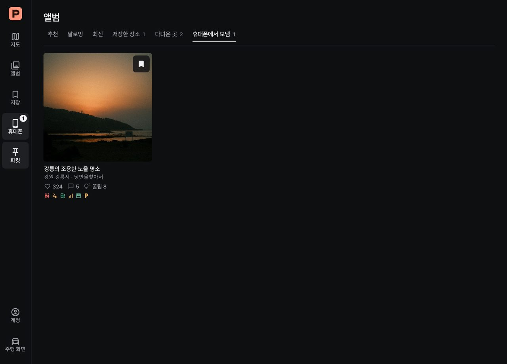
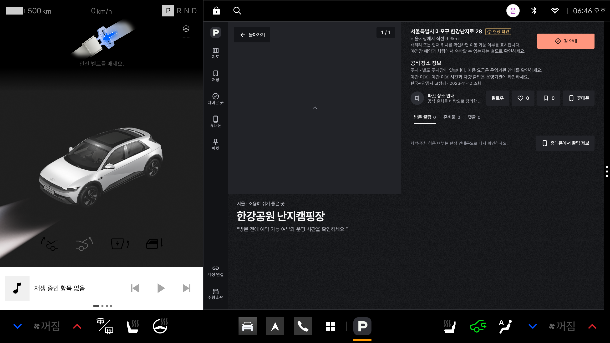
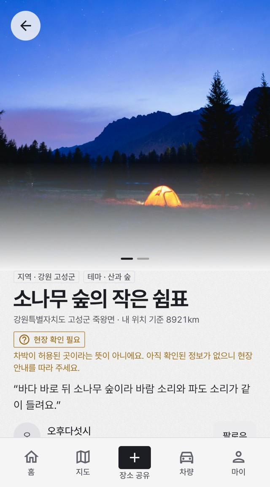
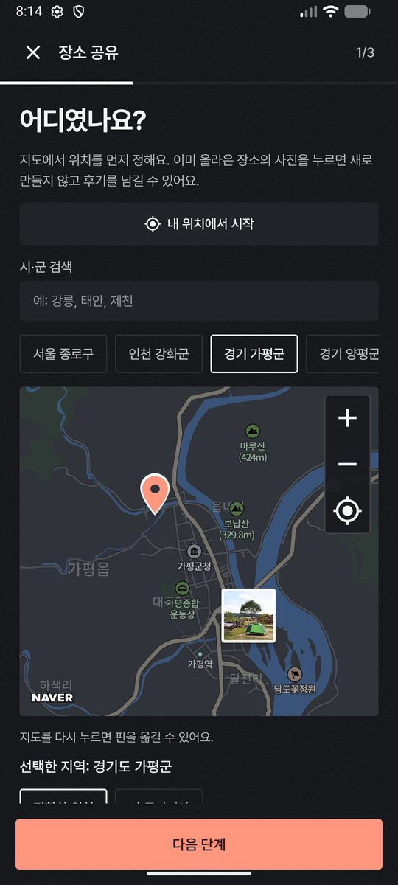
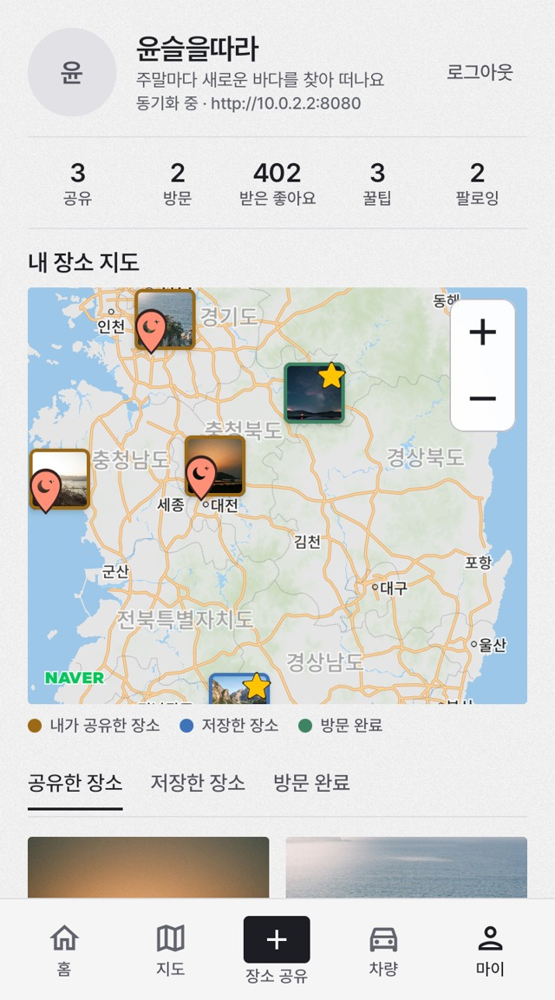
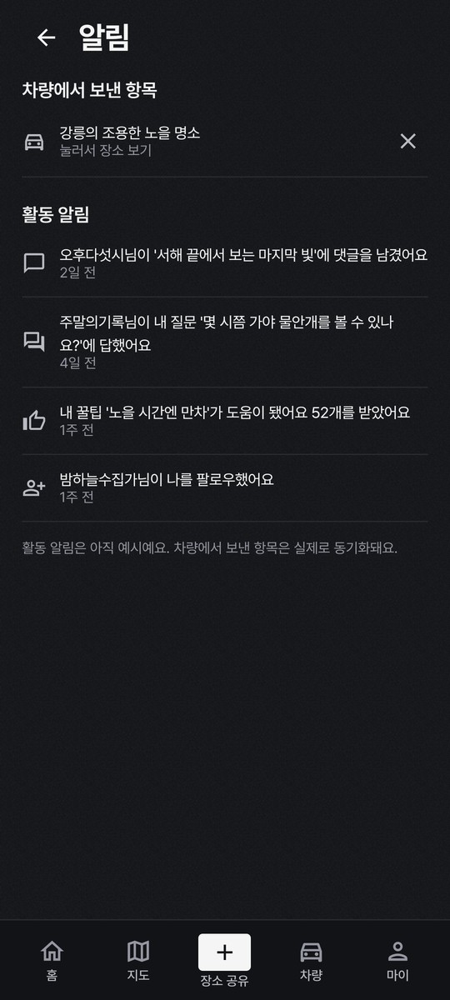

# 현대자동차그룹 차량용 앱 개발 공모전

Pleos Connect 차량용 앱을 만들기 위한 팀 저장소입니다. 차박, 드라이브 장소를 사진과 꿀팁으로 공유하는 차량 특화 SNS **PARK-IT(파킷)** 을 개발하고 있습니다. 슬로건은 "당신의 경험이 누군가의 목적지가 되는 곳"이며, 코드와 패키지 이름은 개발 초기 가칭인 낭만로드(`com.nangmanroad`)를 그대로 씁니다.

**최근 변경 (2026-11-14)** 수정 요청 문서를 반영했습니다. 지역을 고르면 공유 지도가 따라가고, 차량 지도의 조준점은 항상 내 위치로 갑니다. 장소 공유는 지도에서 위치를 먼저 정하고 이미 올라온 장소는 후기로 연결합니다. 차량 전송은 대기, 전송 성공, 수신을 구분해 보여줍니다. 장소 도우미는 뺐습니다. 항목별 내용은 [수정 반영 기록](docs/fix-log-2026-11-14.md)에 있고, 이번 변경 이전에 찍은 스크린샷이 일부 남아 있습니다.

**이전 변경** 차량 수신과 길 안내 시작 상태, 휴대폰 GPS 주변 검색과 방문 조건 필터, 현장 변경 제보, 정차 후 쉬어가기 체크리스트를 추가했습니다. 휴대폰의 수면 모드와 12V 배터리 및 공기질 표시는 데모입니다. 브라우저가 없는 기기에서 외부 링크를 누르면 안내를 표시합니다.

## 화면

2026-11-12 최신 빌드에서 캡처했습니다. 차량용 앱은 Pleos Connect Emulator 2.1.0(2560×1440), 스마트폰 앱은 에뮬레이터의 세로 디스플레이에서 실행했습니다. 샘플 계정으로 차량과 휴대폰을 연결하고 두 앱의 네이버 도로 지도를 확인했습니다.

### 차량용 앱

Pleos 헤드유닛에서는 왼쪽 클러스터 옆 창에 앱이 열립니다. 아래 화면은 앱 창만 잘랐습니다. [라이트 모드 전체 화면](docs/images/car-naver-light.png)

<table>
  <tr>
    <td width="50%"></td>
    <td width="50%"></td>
  </tr>
  <tr>
    <td><b>지도 홈</b> / 사진 마커와 묶음 표시, 분류 필터, 미리보기 카드, 지도에 보이는 지역의 피드, 말로 검색</td>
    <td><b>장소 상세 / 방문 꿀팁</b> / 엇갈리는 정보는 '확인 필요'로 먼저 보여줌</td>
  </tr>
  <tr>
    <td></td>
    <td></td>
  </tr>
  <tr>
    <td><b>준비물</b> / 방문자들이 챙겨 간 물건과 가격, 광고, 제휴 표시, 구매는 휴대폰으로</td>
    <td><b>내 장소</b> / 저장한 장소, 다녀온 곳, 휴대폰에서 보냄 탭과 오늘 해를 보러 간다면</td>
  </tr>
  <tr>
    <td></td>
    <td></td>
  </tr>
  <tr>
    <td><b>휴대폰에서 보냄</b> / 휴대폰의 '차량으로 보내기'가 도착하면 레일에 배지</td>
    <td><b>주행 화면 미리보기</b> / 목적지, 차박 상태, 도착 전 꿀팁</td>
  </tr>
  <tr>
    <td></td>
    <td></td>
  </tr>
  <tr>
    <td><b>계정 연결</b> / 휴대폰에 입력할 6자리 코드(10분마다 새 코드)</td>
    <td><b>연결됨</b> / 저장, 좋아요, 팔로우가 휴대폰과 같아짐, 음성 안내 켜기, 끄기</td>
  </tr>
  <tr>
    <td></td>
    <td></td>
  </tr>
  <tr>
    <td><b>다녀온 곳</b> / 방문 기록</td>
    <td><b>공식 장소 정보</b> / 고캠핑 사진과 출처</td>
  </tr>
</table>

### 스마트폰 앱

<table>
  <tr>
    <td width="25%"></td>
    <td width="25%"></td>
    <td width="25%"></td>
    <td width="25%"></td>
  </tr>
  <tr>
    <td><b>로그인</b></td>
    <td><b>홈</b> / 나를 위한 추천</td>
    <td><b>지도</b></td>
    <td><b>장소 상세</b></td>
  </tr>
  <tr>
    <td></td>
    <td></td>
    <td></td>
    <td></td>
  </tr>
  <tr>
    <td><b>방문 꿀팁</b> / 차량으로 보내기</td>
    <td><b>장소 공유 1/3</b> / 위치 먼저. 이미 올라온 장소는 후기로 연결</td>
    <td><b>장소 공유 2/3</b> / 사진</td>
    <td><b>내 차량</b> / 차량 연결, 콘셉트 사양표</td>
  </tr>
  <tr>
    <td></td>
    <td></td>
    <td></td>
    <td></td>
  </tr>
  <tr>
    <td><b>마이</b> / 내 장소 지도</td>
    <td><b>알림</b> / 차량에서 보낸 항목</td>
    <td><b>가까운 곳</b> / <a href="docs/images/phone-current-detail.jpg">난지캠핑장 상세</a></td>
    <td></td>
  </tr>
</table>

화면이 바뀌면 스크린샷도 같이 바꿉니다. 같은 화면을 띄운 뒤 `scripts/capture-screenshot.sh <기기> <파일 이름> <car|car-full|phone>`을 실행하면 `docs/images/`의 같은 이름 파일이 바뀝니다. 차량 앱 창 자르기와 크기 조절까지 스크립트가 하고, macOS에서만 동작합니다. 자세한 내용은 [외장 SSD 개발 환경](docs/local-environment-mac.md#readme-스크린샷)을 참고하세요.

## 시작하기

**Windows에서 한 번에 실행** Android SDK와 Pleos 에뮬레이터를 설정한 뒤 PowerShell에서 `powershell.exe -ExecutionPolicy Bypass -File .\scripts\run-windows.ps1`을 실행합니다. 서버와 두 앱을 빌드하고, 차량은 메인 화면에, 휴대폰은 세로 보조 화면에 엽니다. 현재 개발 PC에서는 현대차 폴더의 `PARK-IT 실행.cmd`를 더블클릭하면 됩니다.

[개발 환경 설치 및 샘플 실행 안내](docs/development-setup.md)를 따라 Android Studio, JDK 17, Android SDK, Pleos 전용 에뮬레이터와 휴대폰 에뮬레이터를 설치합니다. 도구를 모두 외장 SSD에 둔 개발용 Mac의 경로, 환경 변수, 가상 기기 설정은 [외장 SSD 개발 환경](docs/local-environment-mac.md)에 정리했습니다.

- [차량용 앱](docs/vehicle-app.md): `vehicle/` 모듈의 빌드, 실행 방법, 기능, Pleos SDK 연동, 아직 없는 기능
- [스마트폰 앱](docs/phone-app.md): `phone/` 모듈의 빌드, 실행 방법, 장소 공유, 커뮤니티, 차량 콘셉트 화면, 아직 없는 기능
- [동기화 서버](docs/sync-server.md): `server/` 모듈. 휴대폰 로그인, 6자리 코드로 차량 연결, 저장, 게시물, 보낸 장소 동기화
- 공용 코드: `shared/` 모듈(데이터 모델, 샘플 장소, API 계약)은 서버와 두 앱이, `core/` 모듈(서버 연결, 사진 지도, 공용 UI)은 두 앱이 함께 씁니다.
- [Figma 프로토타입 검토](docs/figma-prototype-review.md): 아이디어 초안 프로토타입에서 구현된 흐름과 빠진 부분

## 참고 링크

- [공모전 참가 가이드](https://appdevchallenge.auto-hmg.io/guide)
- [Pleos Connect 개발자 가이드](https://document.pleos.ai/)
- [공식 Vehicle SDK 샘플](https://github.com/Pleos-Playground/pleos-sample-vehicle-app)
