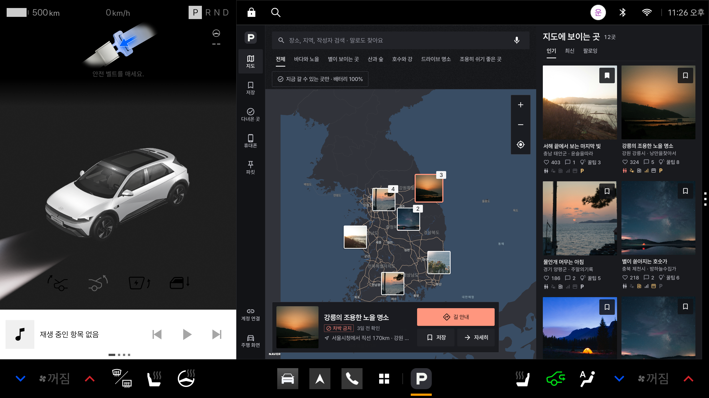
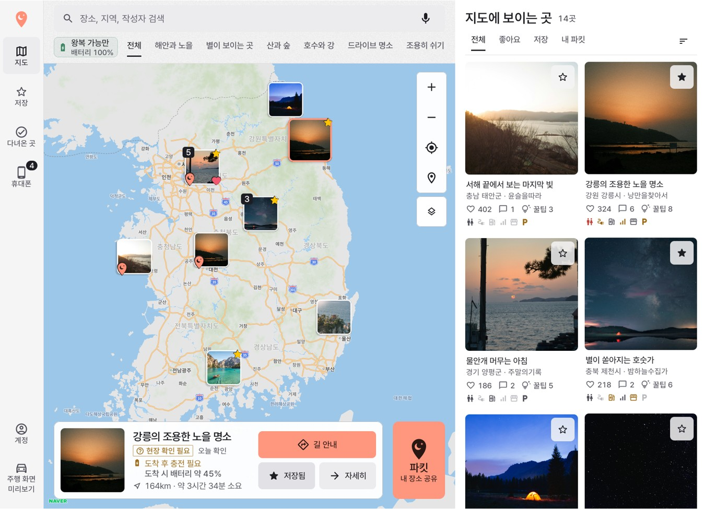
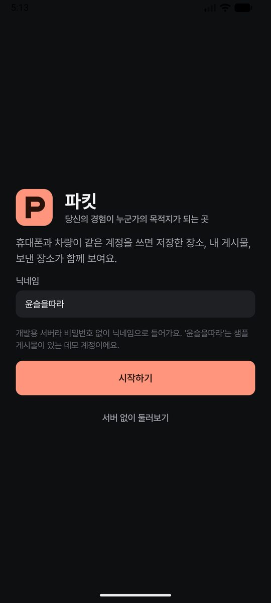
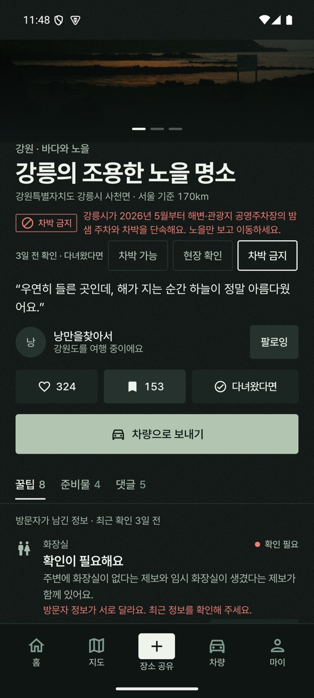

# 현대자동차그룹 차량용 앱 개발 공모전

Pleos Connect 차량용 앱을 만들기 위한 팀 저장소입니다. 차박·드라이브 장소를 사진과 꿀팁으로 공유하는 차량 특화 SNS **PARK-IT(파킷)** 을 개발하고 있습니다. 슬로건은 "당신의 경험이 누군가의 목적지가 되는 곳"이며, 코드와 패키지 이름은 개발 초기 가칭인 낭만로드(`com.nangmanroad`)를 그대로 씁니다.

## 현재 구현된 기능

| 기능 | 현재 동작 |
| --- | --- |
| 지도에서 장소 찾기 | 차량·휴대폰에서 사진 마커와 장소 상세를 볼 수 있습니다. 차량은 장소명·지역·작성자 검색을, 휴대폰은 시설 필터를 지원합니다. 네이버 지도 Client ID가 설정된 빌드는 실제 도로 지도를 사용합니다. |
| 방문 정보 | 차박 가능·금지·현장 확인 상태와 방문자 꿀팁을 표시합니다. 공식 야영장 상세에 고캠핑 사진과 출처를 함께 표시합니다. 확인한 지 90일을 넘긴 차박 정보에는 오래된 정보 표시를 붙입니다. |
| 장소 도우미 | 휴대폰과 정차 중 차량의 장소 상세에서 주차·야간 이용·차박·방문 팁을 확인합니다. 차량에서는 배터리와 도착 시간도 확인할 수 있습니다. 답변은 장소 안내, 방문자 제보, 차량에서 받은 데이터로 만듭니다. |
| 차량 연동 | Vehicle SDK의 기어·배터리 정보로 주행 화면을 전환하고 왕복 가능 여부를 추정합니다. NaviHelper로 목적지를 보내고 남은 거리·시간을 받습니다. 음성 서비스가 연결되면 음성 검색과 도착 전 안내를 이용할 수 있습니다. |
| 파킷과 기기 간 전송 | 6자리 코드로 휴대폰과 차량을 연결합니다. 휴대폰에서 차량으로 장소를 보내거나, 정차 후 “여기, 파킷할까요?”에서 위치와 메모를 휴대폰으로 보내 장소 글을 작성할 수 있습니다. |
| 데이터 저장 | 개발용 동기화 서버는 계정·게시물·제보·전송 목록을 SQLite의 스냅샷으로 저장합니다. 업로드 사진은 기존 폴더에 둡니다. 휴대폰의 원격 차량 제어 화면은 데모입니다. |

## 팀 기준 버전과 비교

GitHub `main`의 `e218ee9`를 기준으로 비교합니다. 신청서의 사진 지도, 지역 피드, 휴대폰과 차량의 연동 흐름을 그대로 바탕으로 삼았습니다.

| 영역 | GitHub `main` | 이번 작업본 |
| --- | --- | --- |
| 화면 | Sage Moon 배색, 사진 지도와 2열 사진 피드 | 차콜·회색과 코랄 배색. 사진 그리드, 하단 카드, “여기, 파킷할까요?” 문구 유지 |
| 지도 | 네이버 지도 SDK 연동과 키가 없을 때의 간략 지도 | 로컬 설정에서 네이버 지도를 연결해 Pleos 실행 화면에 반영 |
| 장소 정보 | 샘플 장소와 사용자가 올린 게시물, 방문자 제보 | 고캠핑 출처가 있는 서울·가평 야영장 3곳, 해당 장소 사진, 공식 안내 영역 추가 |
| 배터리 | 직선거리를 보정해 왕복을 추정. 주행 화면에는 도착 예상 배터리 표시 | 같은 목적지의 남은 도로 경로를 받으면 차량 상세에 반영. 일부 시연 지역의 충전소 후보를 정차 중 상세에서 표시 |
| 서버 | 변경할 때마다 `state.json` 저장 | 첫 실행에 기존 JSON을 읽고 SQLite에 이관. 사진 폴더와 기존 JSON은 보관 |
| 정차 위치 | 위치·메모 전송, 휴대폰에서 초안 열기 | 계정별 기기 내 대기 목록, 연결 복구 후 재전송, 서버 중복 방지, 대략적 위치 설정 전달 |

## 최신 실행 화면

2026-11-12, Pleos Connect Emulator 2.1.0에서 네이버 지도가 연결된 차량 앱을 실행했습니다. 지도·사진 그리드와 하단 장소 카드의 배치는 유지하고, 차콜·회색 바탕에 코랄로 길 안내와 선택한 장소를 강조했습니다. 지도 위 장소와 사진은 시연용 데이터입니다.

[라이트 모드](docs/images/car-naver-light.png) · [차량 장소 상세](docs/images/car-naver-detail.png) · [난지캠핑장 공식 사진과 정보](docs/images/car-official-place.png) · [장소 도우미](docs/images/car-place-assistant.png)

[앱 사용 순서와 시연 영상 체크리스트](docs/demo.md)

## 다음 검증과 확장

**휴대폰에서 고른 장소를 차량에서 안내하고, 정차 위치를 다시 휴대폰에서 초안으로 여는 흐름**을 한 번에 시연하는 것이 목표입니다.

| 순서 | 할 일 | 완료 기준 |
| --- | --- | --- |
| 1 | **차량·휴대폰 연속 시연.** 같은 계정으로 연결하고 장소를 차량으로 보냅니다. Pleos Virtual Console에서 배터리와 기어를 바꿉니다. | 배터리 조건에 따라 안내가 바뀌고, 주행 화면에는 목적지와 남은 거리·시간, 도착 전 정보가 표시됩니다. |
| 2 | **전송 복구 시연.** 정차 상태에서 서버 연결을 끊고 파킷을 보낸 뒤 재연결합니다. | 휴대폰에 한 건만 도착하고, 초안에 메모와 위치 공개 설정이 유지됩니다. |
| 3 | **데이터 범위 확대.** 운영기관 안내로 야간 이용과 차량 진입 조건을 갱신하고, 충전소 조회 API 연동을 검토합니다. | 공식 안내와 제보의 출처를 구분할 수 있고, 실제 운영 상태를 확인한 시각이 표시됩니다. 충전소 경유지 자동 추가는 NaviHelper와 대상 차량에서 별도로 검증합니다. |

데이터 후보는 [한국관광공사 고캠핑 정보](https://www.data.go.kr/data/15101933/openapi.do)와 [한국환경공단 전기자동차 충전소 정보](https://www.data.go.kr/data/15076352/openapi.do)입니다. 차량 기능은 [Vehicle SDK](https://document.pleos.ai/docs/pleos-only/connect-sdk-pleos/Vehicle/intro)와 [NaviHelper SDK](https://document.pleos.ai/en/docs/pleos-only/connect-sdk-pleos/NaviHelper/intro)의 지원 범위를 확인하고, [Pleos Virtual Console](https://document.pleos.ai/en/docs/connect/guide/getting-started/application-development/use-vehicle-emulator)에서 기어와 배터리 조건을 바꿔 검증합니다.

## 휴대폰과 차량 사용 흐름

| 언제 | 화면에서 할 일 | 사용성 확인 기준 |
| --- | --- | --- |
| 출발 전 휴대폰 | 사진으로 장소를 고르고, 주차·야간 이용·차박 상태를 확인한 뒤 ‘차량으로 보내기’를 누릅니다. | 사진을 본 뒤 실제 방문 조건과 전송 버튼을 찾을 수 있는지 확인합니다. |
| 정차 중 차량 | ‘휴대폰에서 보냄’에서 같은 장소를 고르고, 배터리 판정과 확인이 필요한 조건을 본 뒤 ‘길 안내’를 누릅니다. | 장소명을 다시 입력하지 않고 목적지를 찾는지, 추정치와 실제 경로를 구분하는지 봅니다. |
| 주행 중 차량 | 남은 거리·시간과 도착 전 필요한 정보만 확인합니다. 자세한 시설 정보, 사진, 댓글은 정차 후 봅니다. | 운전 중 긴 목록을 스크롤하거나 휴대폰을 꺼낼 필요가 없는지 확인합니다. |
| 정차 후 차량 → 휴대폰 | “여기, 파킷할까요?”에서 위치를 보낸 뒤 휴대폰에서 사진과 팁을 추가합니다. | 전송 대기와 완료를 구분하는지, 위치 공개 수준을 알아보고 수정할 수 있는지 확인합니다. |

시연에서는 전송 후 목적지를 찾는 시간, 중복 전송 건수, 배터리 안내를 맞게 이해한 비율을 관찰합니다. [Android for Cars 디자인 가이드](https://developers.google.com/cars/design/design-foundations)

## 기능별 화면

아래 화면은 2026-11-10에 샘플 계정으로 차량·휴대폰 연동 흐름을 캡처한 기록입니다. 당시 빌드는 내장 간략 지도를 사용했습니다. 차량 이미지는 헤드유닛에서 파킷 앱이 표시되는 영역을 잘라낸 것입니다.

### 차량용 앱

<table>
  <tr>
    <td width="50%"></td>
    <td width="50%"></td>
  </tr>
  <tr>
    <td><b>지도 홈</b> · 사진 마커와 묶음 표시, 분류 필터, 미리보기 카드, 지도에 보이는 지역의 피드, 말로 검색</td>
    <td><b>장소 상세 · 방문 꿀팁</b> · 엇갈리는 정보는 '확인 필요'로 먼저 보여줌</td>
  </tr>
  <tr>
    <td></td>
    <td></td>
  </tr>
  <tr>
    <td><b>준비물</b> · 방문자들이 챙겨 간 물건과 가격, 광고·제휴 표시, 구매는 휴대폰으로</td>
    <td><b>내 장소</b> · 저장한 장소, 다녀온 곳, 휴대폰에서 보냄 탭과 오늘 해를 보러 간다면</td>
  </tr>
  <tr>
    <td></td>
    <td></td>
  </tr>
  <tr>
    <td><b>휴대폰에서 보냄</b> · 휴대폰의 '차량으로 보내기'가 도착하면 레일에 배지</td>
    <td><b>주행 중 화면</b> · 기어가 P가 아니면 목적지와 도착 전 꿀팁만 표시, 출발할 때 음성으로 읽어 주고 말로 물어볼 수 있음</td>
  </tr>
  <tr>
    <td></td>
    <td></td>
  </tr>
  <tr>
    <td><b>계정 연결</b> · 휴대폰에 입력할 6자리 코드(10분마다 새 코드)</td>
    <td><b>연결됨</b> · 저장·좋아요·팔로우가 휴대폰과 같아짐, 음성 안내 켜기·끄기</td>
  </tr>
</table>

### 스마트폰 앱

<table>
  <tr>
    <td width="25%"></td>
    <td width="25%"></td>
    <td width="25%"></td>
    <td width="25%"></td>
  </tr>
  <tr>
    <td><b>로그인</b></td>
    <td><b>홈</b> · 나를 위한 추천</td>
    <td><b>지도</b></td>
    <td><b>장소 상세</b></td>
  </tr>
  <tr>
    <td></td>
    <td></td>
    <td></td>
    <td></td>
  </tr>
  <tr>
    <td><b>방문 꿀팁</b> · 차량으로 보내기</td>
    <td><b>장소 공유 1/3</b> · 사진</td>
    <td><b>장소 공유 2/3</b> · 위치, 위치 공개 수준, 차박 가능 여부</td>
    <td><b>내 차량</b> · 차량 연결, 콘셉트 사양표</td>
  </tr>
  <tr>
    <td></td>
    <td></td>
    <td></td>
    <td></td>
  </tr>
  <tr>
    <td><b>마이</b> · 내 장소 지도</td>
    <td><b>알림</b> · 차량에서 보낸 항목</td>
    <td></td>
    <td></td>
  </tr>
</table>

화면이 바뀌면 스크린샷도 같이 바꿉니다. 같은 화면을 띄운 뒤 `scripts/capture-screenshot.sh <기기> <파일 이름> <car|car-full|phone>`을 실행하면 `docs/images/`의 같은 이름 파일이 바뀝니다. 차량 앱 창 자르기와 크기 조절까지 스크립트가 하고, macOS에서만 동작합니다. 자세한 내용은 [외장 SSD 개발 환경](docs/local-environment-mac.md#readme-스크린샷)을 참고하세요.

## 시작하기

[개발 환경 설치 및 샘플 실행 안내](docs/development-setup.md)를 따라 Android Studio, JDK 17, Android SDK, Pleos 전용 에뮬레이터와 휴대폰 에뮬레이터를 설치합니다. 도구를 모두 외장 SSD에 둔 개발용 Mac의 경로, 환경 변수, 가상 기기 설정은 [외장 SSD 개발 환경](docs/local-environment-mac.md)에 정리했습니다.

- [차량용 앱](docs/vehicle-app.md): `vehicle/` 모듈의 빌드·실행 방법, 기능, Pleos SDK 연동, 아직 없는 기능
- [스마트폰 앱](docs/phone-app.md): `phone/` 모듈의 빌드·실행 방법, 장소 공유·커뮤니티·차량 콘셉트 화면, 아직 없는 기능
- [동기화 서버](docs/sync-server.md): `server/` 모듈. 휴대폰 로그인, 6자리 코드로 차량 연결, 저장·게시물·보낸 장소 동기화
- 공용 코드: `shared/` 모듈(데이터 모델, 샘플 장소, API 계약)은 서버와 두 앱이, `core/` 모듈(서버 연결, 사진 지도, 공용 UI)은 두 앱이 함께 씁니다.
- [Figma 프로토타입 검토](docs/figma-prototype-review.md): 아이디어 초안 프로토타입에서 구현된 흐름과 빠진 부분

## 참고 링크

- [공모전 참가 가이드](https://appdevchallenge.auto-hmg.io/guide)
- [Pleos Connect 개발자 가이드](https://document.pleos.ai/)
- [공식 Vehicle SDK 샘플](https://github.com/Pleos-Playground/pleos-sample-vehicle-app)
