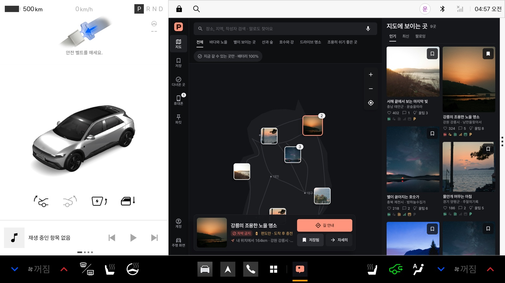
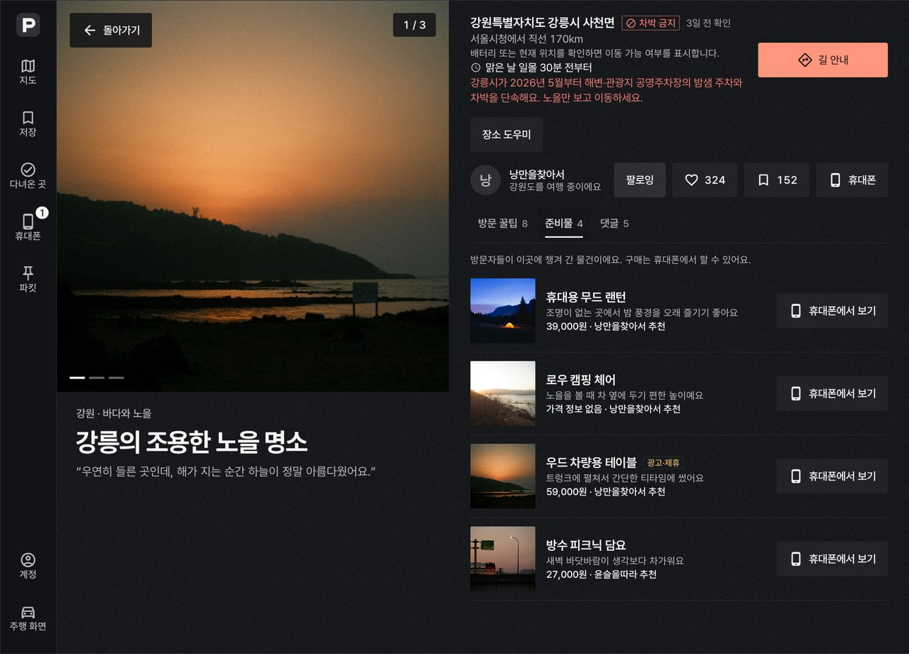
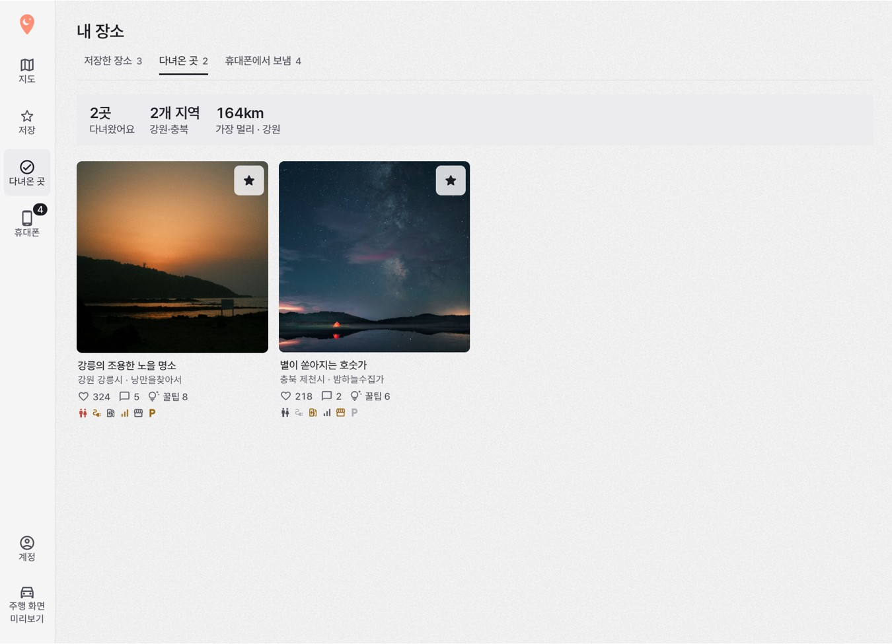
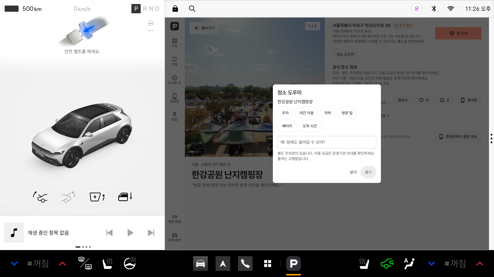
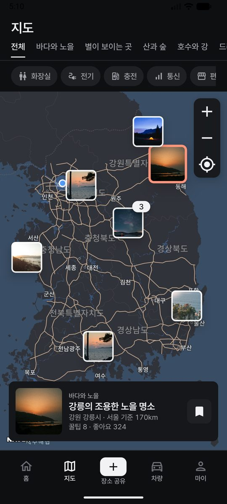
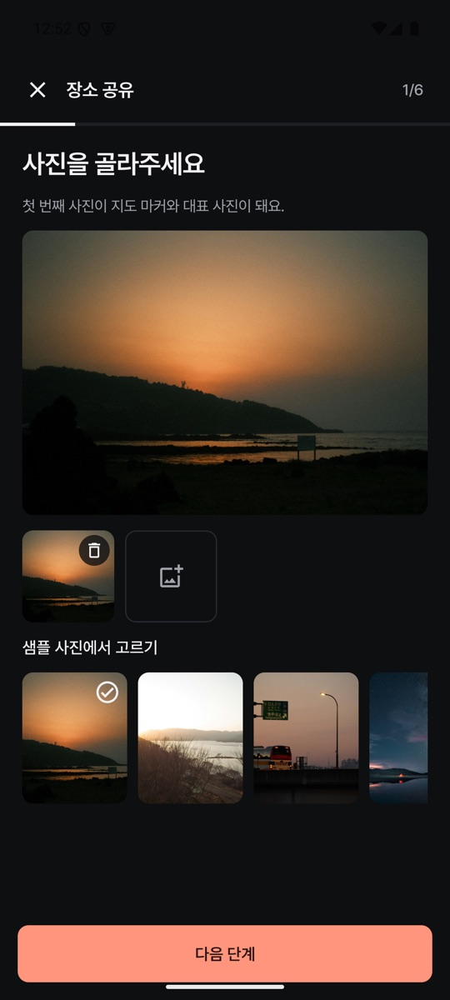
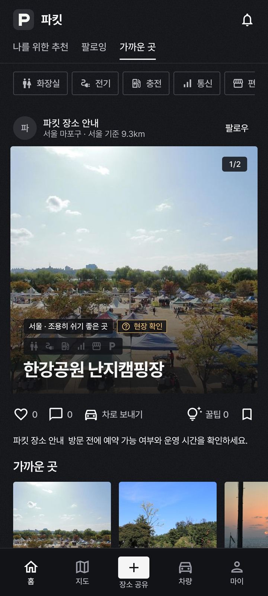

# 현대자동차그룹 차량용 앱 개발 공모전

Pleos Connect 차량용 앱을 만들기 위한 팀 저장소입니다. 차박, 드라이브 장소를 사진과 꿀팁으로 공유하는 차량 특화 SNS **PARK-IT(파킷)** 을 개발하고 있습니다. 슬로건은 "당신의 경험이 누군가의 목적지가 되는 곳"이며, 코드와 패키지 이름은 개발 초기 가칭인 낭만로드(`com.nangmanroad`)를 그대로 씁니다.

**최근 변경** 차량 수신과 길 안내 시작 상태, 휴대폰 GPS 주변 검색과 방문 조건 필터, 현장 변경 제보, 정차 후 쉬어가기 체크리스트를 추가했습니다. 휴대폰의 수면 모드와 12V 배터리 및 공기질 표시는 데모입니다. 브라우저가 없는 기기에서 외부 링크를 누르면 안내를 표시합니다.

## 화면

화면 갤러리는 2026년 11월 12일 빌드에서 캡처했습니다. 아래의 화면별 안내는 현재 소스 기준입니다. 차량용 앱은 Pleos Connect Emulator 2.1.0(2560×1440), 스마트폰 앱은 에뮬레이터의 세로 디스플레이에서 실행했습니다. 샘플 계정으로 차량과 휴대폰을 연결하고 두 앱의 네이버 도로 지도를 확인했습니다.

### 차량용 앱

Pleos 헤드유닛에서는 왼쪽 클러스터 옆 창에 앱이 열립니다. 아래 화면은 앱 창만 잘랐습니다. [라이트 모드 전체 화면](docs/images/car-naver-light.png)

<table>
  <tr>
    <td width="50%"></td>
    <td width="50%"></td>
  </tr>
  <tr>
    <td><b>지도 홈</b> / 사진 마커와 묶음 표시, 분류 필터, 미리보기 카드, 지도에 보이는 지역의 피드, 말로 검색</td>
    <td><b>장소 상세 / 방문 꿀팁</b> / 엇갈리는 정보는 '확인 필요'로 먼저 보여줌</td>
  </tr>
  <tr>
    <td></td>
    <td></td>
  </tr>
  <tr>
    <td><b>준비물</b> / 방문자들이 챙겨 간 물건과 가격, 광고, 제휴 표시, 구매는 휴대폰으로</td>
    <td><b>내 장소</b> / 저장한 장소, 다녀온 곳, 휴대폰에서 보냄 탭과 오늘 해를 보러 간다면</td>
  </tr>
  <tr>
    <td></td>
    <td></td>
  </tr>
  <tr>
    <td><b>휴대폰에서 보냄</b> / 휴대폰의 '차량으로 보내기'가 도착하면 레일에 배지</td>
    <td><b>주행 화면 미리보기</b> / 목적지, 차박 상태, 도착 전 꿀팁</td>
  </tr>
  <tr>
    <td></td>
    <td></td>
  </tr>
  <tr>
    <td><b>계정 연결</b> / 휴대폰에 입력할 6자리 코드(10분마다 새 코드)</td>
    <td><b>연결됨</b> / 저장, 좋아요, 팔로우가 휴대폰과 같아짐, 음성 안내 켜기, 끄기</td>
  </tr>
  <tr>
    <td></td>
    <td></td>
  </tr>
  <tr>
    <td><b>다녀온 곳</b> / 방문 기록</td>
    <td><b>공식 장소 정보</b> / 고캠핑 사진과 출처</td>
  </tr>
  <tr>
    <td></td>
    <td></td>
  </tr>
  <tr>
    <td><b>이전 화면</b> / 장소 도우미</td>
    <td></td>
  </tr>
</table>

### 스마트폰 앱

<table>
  <tr>
    <td width="25%"></td>
    <td width="25%"></td>
    <td width="25%"></td>
    <td width="25%"></td>
  </tr>
  <tr>
    <td><b>로그인</b></td>
    <td><b>홈</b> / 나를 위한 추천</td>
    <td><b>지도</b></td>
    <td><b>장소 상세</b></td>
  </tr>
  <tr>
    <td></td>
    <td></td>
    <td></td>
    <td></td>
  </tr>
  <tr>
    <td><b>방문 꿀팁</b> / 차량으로 보내기</td>
    <td><b>당시 공유 화면</b> / 사진</td>
    <td><b>당시 공유 화면</b> / 위치, 위치 공개 수준, 차박 가능 여부</td>
    <td><b>내 차량</b> / 차량 연결, 콘셉트 사양표</td>
  </tr>
  <tr>
    <td></td>
    <td></td>
    <td></td>
    <td></td>
  </tr>
  <tr>
    <td><b>마이</b> / 내 장소 지도</td>
    <td><b>알림</b> / 차량에서 보낸 항목</td>
    <td><b>가까운 곳</b> / <a href="docs/images/phone-current-detail.jpg">난지캠핑장 상세</a></td>
    <td><b>이전 화면</b> / 장소 도우미</td>
  </tr>
</table>

## 차량용 앱 화면 안내

| 화면 | 들어가는 곳 | 할 수 있는 일 |
| --- | --- | --- |
| 지도 홈 | 앱 시작 또는 왼쪽 **지도** | 마커를 누르면 하단에 장소가 나옵니다. 묶음은 누르면 확대됩니다. 차량에서 **전체**, **좋아요**, **저장**, **내 파킷**을 고르면 지도와 목록에 함께 적용됩니다. 목록의 정렬 아이콘에서 인기·최신·팔로잉을 고를 수 있습니다. 차량과 휴대폰 지도 모두 오른쪽 레이어 버튼에서 사진·아이콘·점으로 바꿀 수 있습니다. 별은 저장한 곳, 하트는 좋아요를 누른 곳, 코랄 파킷 핀은 내가 올린 곳입니다. |
| 검색과 방문 조건 | 지도 상단 | 장소명, 지역, 작성자로 찾습니다. 분류를 고르거나 배터리 기준으로 지금 갈 수 있는 곳만 남길 수 있습니다. 차량에서 음성 인식이 지원되면 마이크로 검색할 수 있습니다. |
| 위치 버튼 | 지도 오른쪽 | 조준점은 차량 위치로, 핀은 선택한 장소로 이동합니다. 차량 위치를 받지 못했으면 안내를 띄웁니다. |
| 장소 미리보기와 상세 | 사진 마커 → **자세히** | 거리, 지역, 차박 상태, 배터리 판정을 보고 저장하거나 길 안내를 시작합니다. 상세의 사진을 넘겨 보고 휴대폰으로 장소를 보낼 수 있습니다. |
| 방문 꿀팁과 공식 장소 | 상세 → **방문 꿀팁** | 주차·화장실 등 방문 전 알아둘 정보를 봅니다. 제보가 엇갈리면 확인 필요로 표시합니다. 공식 장소는 사진과 운영 정보의 출처를 표시합니다. |
| 준비물과 댓글 | 상세 → **준비물**, **댓글** | 방문자가 추천한 물건과 후기, 질문과 답글을 봅니다. 구매 검색이나 글 작성은 휴대폰에서 이어갑니다. |
| 저장과 다녀온 곳 | 왼쪽 **저장**, **다녀온 곳** | 저장한 장소와 방문 기록을 각각 확인합니다. 사진을 누르면 장소 상세를 엽니다. |
| 휴대폰에서 받은 장소 | 왼쪽 **휴대폰** | 휴대폰에서 보낸 장소가 쌓입니다. 새 장소가 도착하면 배지와 장소 이름이 담긴 안내가 뜹니다. **장소 열기**로 상세를 열고 필요할 때 길 안내를 시작합니다. |
| 파킷 보내기 | 지도 오른쪽 아래 **파킷** | 지도 위 **파킷 · 정차 위치 보내기**를 누르면 현재 위치와 전송 버튼이 펼쳐집니다. 주행 후 정차하면 버튼이 강조됩니다. 음성 메모를 함께 보낼 수 있고, 기존 장소에 도착했다면 방문 기록을 남깁니다. 장소를 알고 있는 경우 쉬어가기 체크리스트도 열 수 있습니다. |
| 계정 연결과 설정 | 왼쪽 **계정 연결** 또는 **계정** | 차량의 6자리 번호를 휴대폰 차량 탭에 입력합니다. 연결 뒤에는 음성 안내를 켜고 끄거나 파킷 위치를 시·군까지만 보낼 수 있습니다. |
| 주행 화면 | 주행 시작 또는 왼쪽 **주행 화면** 미리보기 | 주행 중 사진과 피드를 가리고, 경로가 있을 때 목적지, 남은 거리·시간, 도착 전 꿀팁을 보여줍니다. 음성 안내는 Pleos의 음성 모델이 있는 환경에서 동작합니다. |

## 휴대폰 앱 화면 안내

| 화면 | 들어가는 곳 | 할 수 있는 일 |
| --- | --- | --- |
| 로그인과 둘러보기 | 앱을 처음 열 때 | 데모 계정으로 로그인합니다. 둘러보기에서도 기본 화면을 볼 수 있고, 차량 연동과 서버 동기화에는 로그인이 필요합니다. |
| 홈 | 하단 **홈** | **나를 위한 추천**, **팔로잉**, **가까운 곳**을 읽습니다. 사진을 넘겨 보고 저장, 좋아요, 후기 보기를 할 수 있습니다. **차량으로 보내기**는 보고 있는 장소를 차량의 받은 목록에 올리는 동작입니다. |
| 가까운 곳과 방문 조건 | 홈 → **가까운 곳**, 지도 상단 | 위치 권한을 주면 내 위치 기준으로 거리를 봅니다. 화장실, 전기, 충전 등 시설과 방문 조건을 여러 개 고르면 모두 맞는 장소만 남습니다. |
| 지도 | 하단 **지도** | 사진을 누르면 하단 카드가 열립니다. 홈에서 고른 시설과 방문 조건이 지도에도 이어집니다. |
| 장소 상세 | 피드 사진 또는 지도 카드 | 사진, 위치와 차박 상태, 운영 정보, 작성자와 방문 팁을 봅니다. **방문 기록**은 내 방문 목록에, **차박 상태 제보**는 장소 정보에 반영됩니다. |
| 방문 꿀팁과 현장 변경 | 상세 → **꿀팁** | 도움이 된 제보에 표시를 남기거나 시설·진입로·폐쇄 등 현장의 변화를 제보합니다. 제보 화면을 스크롤하면서 입력할 수 있습니다. |
| 준비물과 후기 | 상세 → **준비물**, **댓글** | 준비물의 가격과 추천 이유를 보고 저장하거나 쇼핑을 검색합니다. 댓글에서는 방문 후기와 질문을 쓰고 답글을 남깁니다. |
| 위치 정하기 | 하단 **장소 공유** → **새 장소 등록** | 지도를 눌러 핀을 찍거나 시·군·구를 검색해 지도 화면을 이동합니다. 시·도를 고르면 해당 지역으로 검색 범위가 좁아집니다. 내 위치를 사용할 수도 있습니다. 위치를 시·군까지만 공개할지 정하고, 차박 상태와 방문 조건을 입력합니다. |
| 사진 고르기 | 새 장소 등록 2단계 | 갤러리 또는 샘플 사진을 고릅니다. 첫 번째 사진을 대표 사진과 지도 마커에 씁니다. |
| 소개 작성과 게시 | 새 장소 등록 3단계 | 제목, 경험, 분류, 가기 좋은 때를 적습니다. **더 쓰기**를 열면 꿀팁, 준비물, 공개 범위를 추가로 설정할 수 있습니다. |
| 기존 장소 후기 | **장소 공유** → **기존 장소 후기** | 장소 이름이나 지역으로 찾고 선택하면 기존 상세의 댓글 화면이 열립니다. 같은 장소에 후기를 남길 수 있습니다. |
| 내 차량 | 하단 **차량** | 6자리 번호로 차량을 연결합니다. 차량으로 보낸 장소가 **보냄 / 차량 수신 대기**, **차량 수신**, **길 안내 시작** 중 어디까지 갔는지 볼 수 있습니다. 배터리, 차박 모드와 원격 제어는 데모입니다. |
| 마이 | 하단 **마이** | 공유한 장소, 저장한 장소, 방문 완료를 목록과 지도에서 봅니다. |
| 알림과 파킷리스트 | 홈 오른쪽 위 **알림** | **파킷리스트**에 차량에서 전송한 정차 위치와 메모가 모입니다. 새 위치를 누르면 핀이 찍힌 장소 공유가 열리고, 기존 장소는 상세에서 방문 정보를 확인할 수 있습니다. 차량이 보낸 일반 장소와 상품은 별도 목록에 표시됩니다. |

**장소 보내기와 파킷 보내기** 휴대폰에서 차량으로 보내면 기존 장소가 차량의 **휴대폰** 메뉴로 갑니다. 차량에서 파킷을 보내면 정차 위치와 함께 남긴 메모가 휴대폰의 **알림 → 파킷리스트**에 들어옵니다.

화면이 바뀌면 스크린샷도 같이 바꿉니다. 같은 화면을 띄운 뒤 `scripts/capture-screenshot.sh <기기> <파일 이름> <car|car-full|phone>`을 실행하면 `docs/images/`의 같은 이름 파일이 바뀝니다. 차량 앱 창 자르기와 크기 조절까지 스크립트가 하고, macOS에서만 동작합니다. 자세한 내용은 [외장 SSD 개발 환경](docs/local-environment-mac.md#readme-스크린샷)을 참고하세요.

## 시작하기

**Windows에서 한 번에 실행** Android SDK와 Pleos 에뮬레이터를 설정한 뒤 저장소 루트의 `run-parkit.cmd`를 실행합니다. 서버와 두 앱을 빌드하고, 한 에뮬레이터 창의 왼쪽에는 차량, 오른쪽에는 휴대폰을 엽니다.

휴대폰에 로그인한 뒤 **장소 공유 → 공유하기**를 누르면 같은 CMD가 실행한 PC의 로컬 서버에 등록됩니다. 둘러보기로 시작했다면 장소를 이 휴대폰에 저장합니다.

[개발 환경 설치 및 샘플 실행 안내](docs/development-setup.md)를 따라 Android Studio, JDK 17, Android SDK, Pleos 전용 에뮬레이터와 휴대폰 에뮬레이터를 설치합니다. 도구를 모두 외장 SSD에 둔 개발용 Mac의 경로, 환경 변수, 가상 기기 설정은 [외장 SSD 개발 환경](docs/local-environment-mac.md)에 정리했습니다.

- [차량용 앱](docs/vehicle-app.md): `vehicle/` 모듈의 빌드, 실행 방법, 기능, Pleos SDK 연동, 아직 없는 기능
- [스마트폰 앱](docs/phone-app.md): `phone/` 모듈의 빌드, 실행 방법, 장소 공유, 커뮤니티, 차량 콘셉트 화면, 아직 없는 기능
- [동기화 서버](docs/sync-server.md): `server/` 모듈. 휴대폰 로그인, 6자리 코드로 차량 연결, 저장, 게시물, 보낸 장소 동기화
- 공용 코드: `shared/` 모듈(데이터 모델, 샘플 장소, API 계약)은 서버와 두 앱이, `core/` 모듈(서버 연결, 사진 지도, 공용 UI)은 두 앱이 함께 씁니다.
- [Figma 프로토타입 검토](docs/figma-prototype-review.md): 아이디어 초안 프로토타입에서 구현된 흐름과 빠진 부분

## 참고 링크

- [공모전 참가 가이드](https://appdevchallenge.auto-hmg.io/guide)
- [Pleos Connect 개발자 가이드](https://document.pleos.ai/)
- [공식 Vehicle SDK 샘플](https://github.com/Pleos-Playground/pleos-sample-vehicle-app)
