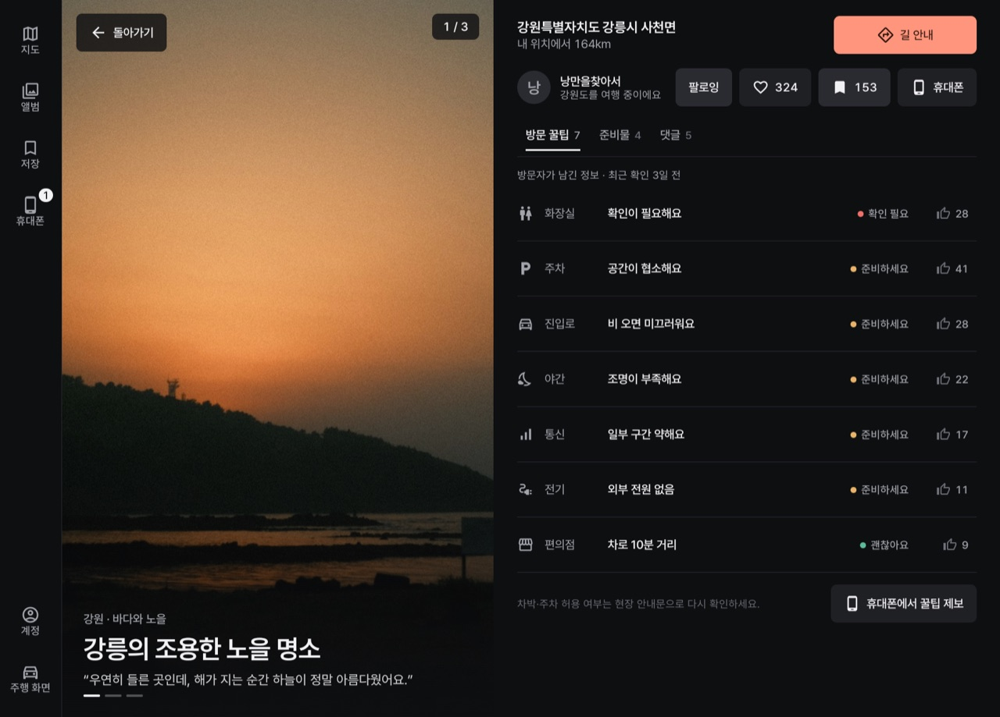
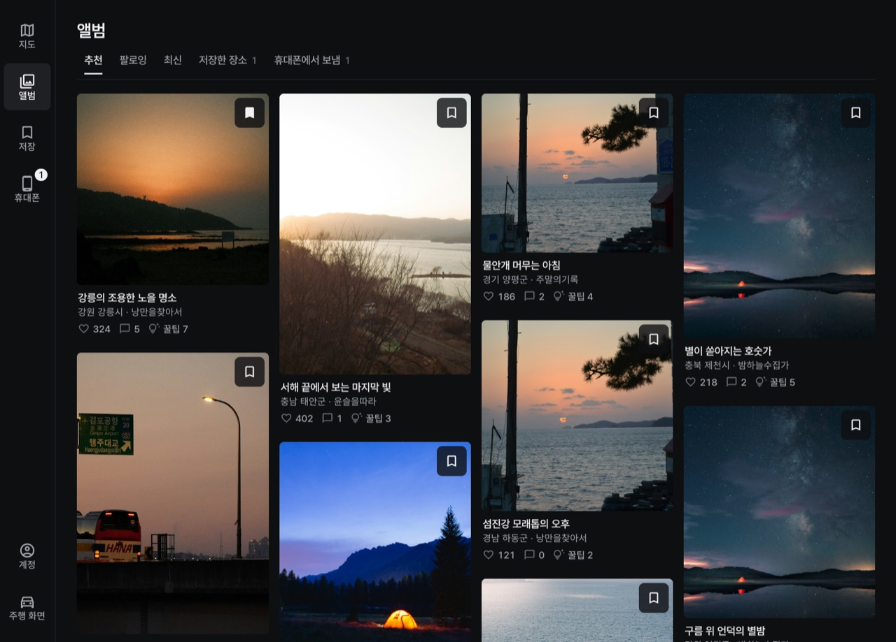
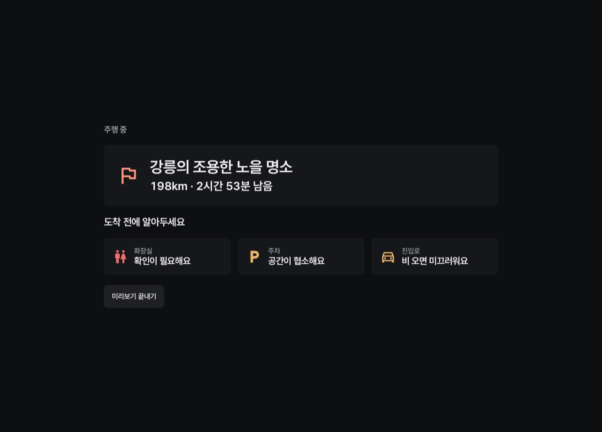
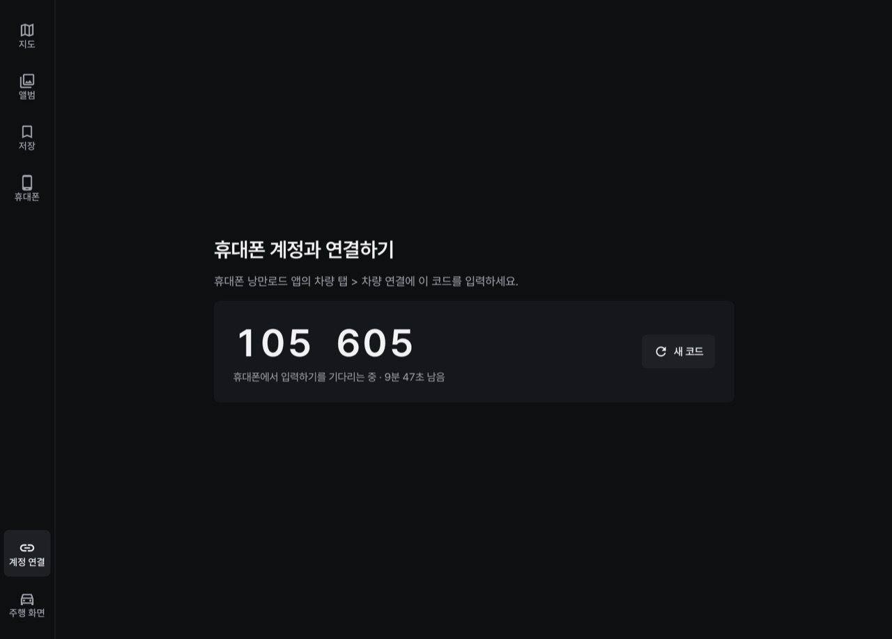
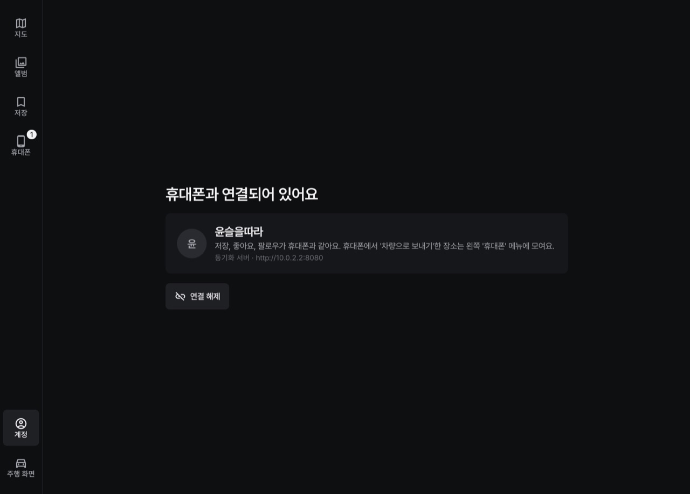
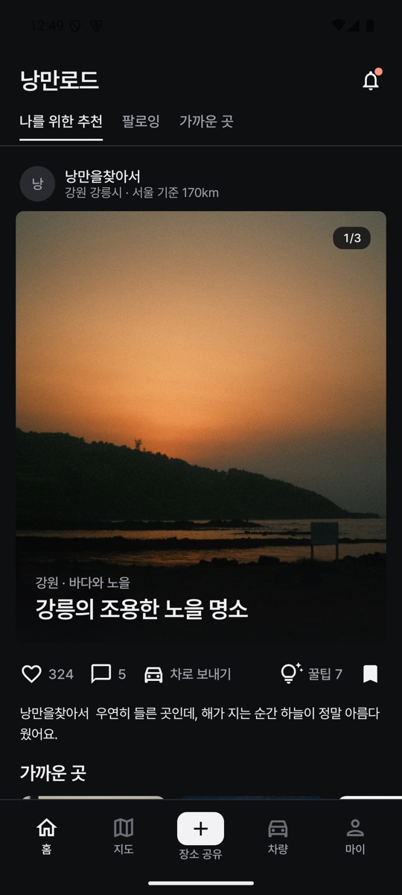
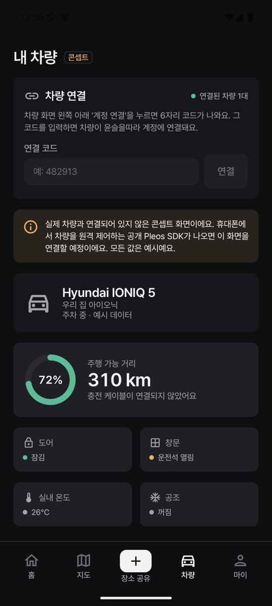

# 현대자동차그룹 차량용 앱 개발 공모전

Pleos Connect 차량용 앱을 만들기 위한 팀 저장소입니다. 차박·드라이브 장소를 사진과 꿀팁으로 공유하는 위치 기반 SNS **낭만로드**(가칭)를 개발하고 있습니다.

## 화면

에뮬레이터에서 실제 앱을 실행해 찍은 화면입니다. 차량은 Pleos Connect Emulator 2.1.0(2560×1440), 휴대폰은 Pixel 7(Android 15)이고, 두 기기가 동기화 서버로 `윤슬을따라` 계정에 연결된 상태입니다. 장소와 사진은 샘플 데이터입니다.

### 차량용 앱

Pleos 헤드유닛에서는 왼쪽 클러스터 옆 창에 앱이 열립니다. 아래 화면은 그 앱 창만 잘라낸 것입니다.

<table>
  <tr>
    <td width="50%"></td>
    <td width="50%"></td>
  </tr>
  <tr>
    <td><b>지도 홈</b> · 사진 마커와 묶음 표시, 분류 필터, 미리보기 카드, 지도에 보이는 지역의 피드</td>
    <td><b>장소 상세 · 방문 꿀팁</b> · 엇갈리는 정보는 '확인 필요'로 먼저 보여줌</td>
  </tr>
  <tr>
    <td></td>
    <td></td>
  </tr>
  <tr>
    <td><b>준비물</b> · 방문자들이 챙겨 간 물건과 가격, 광고·제휴 표시, 구매는 휴대폰으로</td>
    <td><b>앨범</b> · 추천, 팔로잉, 최신, 저장한 장소, 휴대폰에서 보냄 탭</td>
  </tr>
  <tr>
    <td></td>
    <td></td>
  </tr>
  <tr>
    <td><b>휴대폰에서 보냄</b> · 휴대폰의 '차량으로 보내기'가 도착하면 레일에 배지</td>
    <td><b>주행 중 화면</b> · 기어가 P가 아니면 목적지와 도착 전 꿀팁만 표시</td>
  </tr>
  <tr>
    <td></td>
    <td></td>
  </tr>
  <tr>
    <td><b>계정 연결</b> · 휴대폰에 입력할 6자리 코드(10분마다 새 코드)</td>
    <td><b>연결됨</b> · 저장·좋아요·팔로우가 휴대폰과 같아짐</td>
  </tr>
</table>

### 스마트폰 앱

<table>
  <tr>
    <td width="25%"></td>
    <td width="25%"></td>
    <td width="25%"></td>
    <td width="25%"></td>
  </tr>
  <tr>
    <td><b>로그인</b></td>
    <td><b>홈</b> · 나를 위한 추천</td>
    <td><b>지도</b></td>
    <td><b>장소 상세</b></td>
  </tr>
  <tr>
    <td></td>
    <td></td>
    <td></td>
    <td></td>
  </tr>
  <tr>
    <td><b>방문 꿀팁</b> · 차량으로 보내기</td>
    <td><b>장소 공유 1/6</b> · 사진</td>
    <td><b>장소 공유 2/6</b> · 위치</td>
    <td><b>내 차량</b> · 차량 연결, 콘셉트 화면</td>
  </tr>
  <tr>
    <td></td>
    <td></td>
    <td></td>
    <td></td>
  </tr>
  <tr>
    <td><b>마이</b> · 내 장소 지도</td>
    <td><b>알림</b> · 차량에서 보낸 항목</td>
    <td></td>
    <td></td>
  </tr>
</table>

화면이 바뀌면 스크린샷도 같이 바꿉니다. 같은 화면을 띄운 뒤 `scripts/capture-screenshot.sh <기기> <파일 이름> <car|car-full|phone>`을 실행하면 `docs/images/`의 같은 이름 파일이 바뀝니다. 차량 앱 창 자르기와 크기 조절까지 스크립트가 하고, macOS에서만 동작합니다. 자세한 내용은 [외장 SSD 개발 환경](docs/local-environment-mac.md#readme-스크린샷)을 참고하세요.

## 시작하기

[개발 환경 설치 및 샘플 실행 안내](docs/development-setup.md)를 따라 Android Studio, JDK 17, Android SDK, Pleos 전용 에뮬레이터와 휴대폰 에뮬레이터를 설치합니다. 도구를 모두 외장 SSD에 둔 개발용 Mac의 경로, 환경 변수, 가상 기기 설정은 [외장 SSD 개발 환경](docs/local-environment-mac.md)에 정리했습니다.

- [차량용 앱](docs/vehicle-app.md): `vehicle/` 모듈의 빌드·실행 방법, 기능, Pleos SDK 연동, 아직 없는 기능
- [스마트폰 앱](docs/phone-app.md): `phone/` 모듈의 빌드·실행 방법, 장소 공유·커뮤니티·차량 콘셉트 화면, 아직 없는 기능
- [동기화 서버](docs/sync-server.md): `server/` 모듈. 휴대폰 로그인, 6자리 코드로 차량 연결, 저장·게시물·보낸 장소 동기화
- 공용 코드: `shared/` 모듈(데이터 모델, 샘플 장소, API 계약)은 서버와 두 앱이, `core/` 모듈(서버 연결, 사진 지도, 공용 UI)은 두 앱이 함께 씁니다.
- [Figma 프로토타입 검토](docs/figma-prototype-review.md): 아이디어 초안 프로토타입에서 구현된 흐름과 빠진 부분

## 참고 링크

- [공모전 참가 가이드](https://appdevchallenge.auto-hmg.io/guide)
- [Pleos Connect 개발자 가이드](https://document.pleos.ai/)
- [공식 Vehicle SDK 샘플](https://github.com/Pleos-Playground/pleos-sample-vehicle-app)
