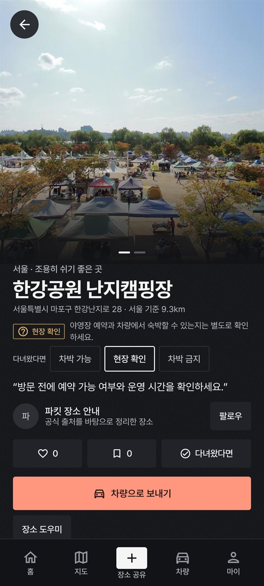
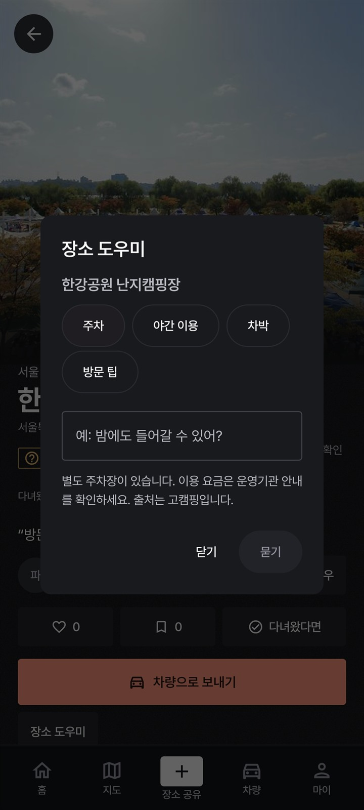

# PARK-IT (파킷)

현대자동차그룹 차량용 앱 개발 공모전 프로젝트. 휴대폰에서 차박·드라이브 장소를 찾고 차량으로 보낸 뒤, 방문한 장소의 사진과 팁을 공유합니다. 차량용 앱은 Pleos Connect에서 실행합니다.

## 이번 업데이트

- 차량·휴대폰 테마에 차콜과 코랄 적용. 두 앱에서 네이버 도로 지도 표시 확인.
- 고캠핑 야영장 3곳의 사진 6장, 주차·야간 이용 안내, 출처·조회일 추가.
- 장소 도우미에서 주차·야간 이용·차박·방문 팁 확인.
- 같은 목적지의 남은 도로 거리로 배터리 추정 보강.
- 정차 위치 전송 대기·재시도와 서버 중복 방지. 서버 저장은 SQLite로 이관.

## 실행 화면

2026-11-12 최신 빌드와 샘플 계정으로 캡처했습니다. 휴대폰 화면은 에뮬레이터의 세로 디스플레이에서 촬영했습니다.

### 차량용 앱

[라이트 모드](docs/images/car-naver-light.png) · [난지캠핑장 공식 사진과 정보](docs/images/car-official-place.png) · [장소 도우미](docs/images/car-place-assistant.png)

차량 기능별 화면

| 탐색·방문 | 계정·주행 |
| --- | --- |
| [지도 홈과 지역 피드](docs/images/car-map.jpg) | [휴대폰에서 보낸 장소](docs/images/car-from-phone.jpg) |
| [장소 상세와 방문 꿀팁](docs/images/car-detail-tips.jpg) | [6자리 연결 코드](docs/images/car-pairing.jpg) |
| [준비물](docs/images/car-detail-items.jpg) | [연결된 계정과 음성 안내 설정](docs/images/car-account.jpg) |
| [저장한 장소와 일몰 안내](docs/images/car-album.jpg) | [주행 화면 미리보기](docs/images/car-driving.jpg) |
| [다녀온 곳](docs/images/car-visited.jpg) | |

### 휴대폰 앱

| 홈 | 지도 | 장소 상세 | 장소 도우미 |
| --- | --- | --- | --- |
|  |  |  |  |

휴대폰 기능별 화면

| 장소 탐색·공유 | 계정·차량 |
| --- | --- |
| [가까운 곳](docs/images/phone-current-home.jpg) | [로그인](docs/images/phone-signin.jpg) |
| [사진 상세와 방문 기록](docs/images/phone-detail.jpg) | [차량 연결·제어 데모](docs/images/phone-car.jpg) |
| [방문 꿀팁](docs/images/phone-tips.jpg) | [프로필과 내 장소 지도](docs/images/phone-profile.jpg) |
| [장소 공유 · 사진 선택](docs/images/phone-share-photo.jpg) | [차량에서 보낸 항목과 알림](docs/images/phone-notifications.jpg) |
| [장소 공유 · 위치와 공개 범위](docs/images/phone-share-place.jpg) | |

## 시작하기

[개발 환경 설치 및 샘플 실행 안내](docs/development-setup.md)를 따라 Android Studio, JDK 17, Android SDK, Pleos 전용 에뮬레이터와 휴대폰 에뮬레이터를 설치합니다. 도구를 모두 외장 SSD에 둔 개발용 Mac의 경로, 환경 변수, 가상 기기 설정은 [외장 SSD 개발 환경](docs/local-environment-mac.md)에 정리했습니다.

- [차량용 앱](docs/vehicle-app.md): `vehicle/` 모듈의 빌드·실행 방법, 기능, Pleos SDK 연동, 아직 없는 기능
- [스마트폰 앱](docs/phone-app.md): `phone/` 모듈의 빌드·실행 방법, 장소 공유·커뮤니티·차량 콘셉트 화면, 아직 없는 기능
- [동기화 서버](docs/sync-server.md): `server/` 모듈. 휴대폰 로그인, 6자리 코드로 차량 연결, 저장·게시물·보낸 장소 동기화
- 공용 코드: `shared/` 모듈(데이터 모델, 샘플 장소, API 계약)은 서버와 두 앱이, `core/` 모듈(서버 연결, 사진 지도, 공용 UI)은 두 앱이 함께 씁니다.
- [Figma 프로토타입 검토](docs/figma-prototype-review.md): 아이디어 초안 프로토타입에서 구현된 흐름과 빠진 부분

## 참고 링크

- [공모전 참가 가이드](https://appdevchallenge.auto-hmg.io/guide)
- [Pleos Connect 개발자 가이드](https://document.pleos.ai/)
- [공식 Vehicle SDK 샘플](https://github.com/Pleos-Playground/pleos-sample-vehicle-app)
