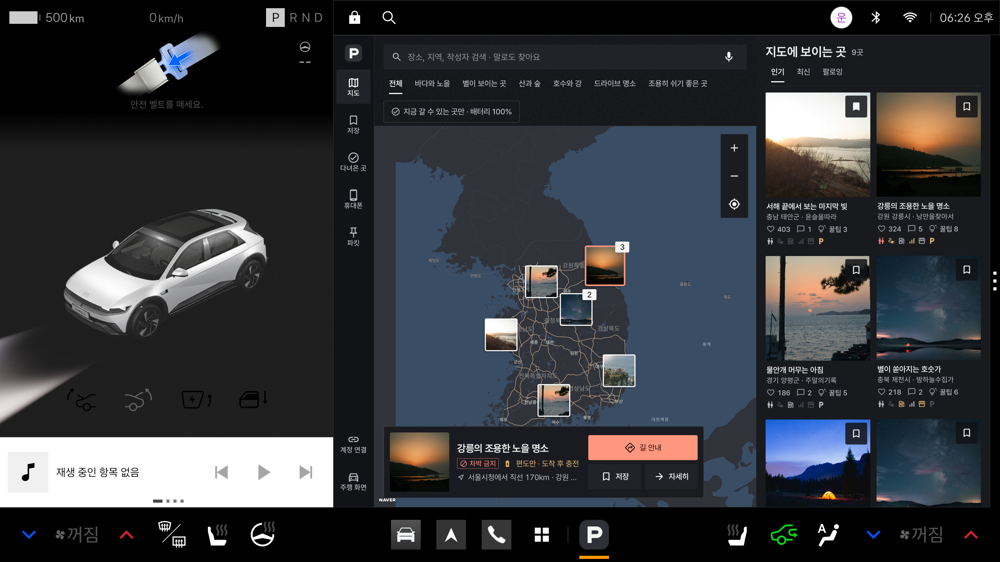

# 파킷 시연 준비

파킷의 시연은 휴대폰에서 장소를 고르는 장면으로 시작합니다. 같은 장소를 차량에서 열어 길 안내를 시작하고, 도착 후 차량에서 보낸 위치를 휴대폰에서 다시 여는 장면으로 마무리합니다.

## 최신 차량 화면

아래 이미지는 GitHub에 반영된 앱 커밋 `d3b4f0e`의 검토 빌드에서 촬영했습니다. 네이버 지도는 빌드할 때 Client ID를 설정해 표시했습니다.

[라이트 모드](images/car-naver-light.png) · [장소 상세와 방문 꿀팁](images/car-naver-detail.png) · [난지캠핑장 공식 사진과 정보](images/car-official-place.png) · [장소 도우미](images/car-place-assistant.png)

## 직접 사용해 보기

1. [개발 환경 안내](development-setup.md#네이버-지도-키)에 따라 네이버 지도 Client ID를 로컬에서 설정하고, 같은 버전의 차량·휴대폰 APK를 각각 설치합니다.
2. [동기화 서버](sync-server.md)를 실행하고 휴대폰에서 로그인합니다. 차량의 **계정 연결**에 표시된 6자리 코드를 휴대폰 **차량 → 차량 연결**에 입력합니다.
3. 휴대폰에서 장소를 열고 **차량으로 보내기**를 누릅니다. 정차 중 차량의 **휴대폰 → 휴대폰에서 보냄**에서 같은 장소를 골라 거리·배터리·방문 정보를 확인하고 **길 안내**를 누릅니다.
4. Pleos 에뮬레이터에서 주행 상태를 바꿔 간소화 화면을 확인합니다. 다시 P단으로 전환한 후 **여기, 파킷할까요? → 파킷하기**를 누릅니다.
5. 휴대폰의 **알림 → 차량에서 보낸 항목**을 엽니다. 새 위치는 장소 공유 초안으로, 기존 장소는 방문 정보를 확인하는 화면으로 이어집니다.

정차 중 장소 상세에서 **장소 도우미 → 주차**를 누르면 고캠핑 안내나 방문자 제보를 확인할 수 있습니다. 차량에서 배터리와 현재 위치를 받으면 같은 곳에서 이동 가능 여부를 확인할 수 있습니다.

## 시연 영상 구성

| 시간 | 화면 | 전달할 내용 |
| --- | --- | --- |
| 0–12초 | 휴대폰 사진 피드 → 장소 상세 | “사진으로 마음에 드는 곳을 찾고, 주차와 방문 조건을 확인합니다.” |
| 12–25초 | 차량으로 보내기 → 차량의 ‘휴대폰에서 보냄’ | “휴대폰에서 고른 장소가 차량에 도착합니다.” |
| 25–42초 | 차량 지도·상세 → 배터리 판정 → 길 안내 → 주행 화면 | “출발 전에 거리와 배터리를 확인하고, 달리는 동안에는 도착에 필요한 정보만 봅니다.” |
| 42–62초 | P단 → 파킷하기 → 휴대폰 알림과 초안 | “도착하면 위치를 휴대폰으로 보내고, 사진과 팁을 더해 공유합니다.” |

홍보용으로 짧게 편집할 때는 **휴대폰으로 장소 선택 → 차량에 도착 → 정차 후 휴대폰으로 돌아오는 장면**을 이어 붙입니다. 사용법 영상은 위 순서대로 버튼과 화면 이름을 보여줍니다.

## 녹화 전 확인

- [ ] 한 장소를 골라 동일 계정의 휴대폰과 차량에서 처음부터 끝까지 실행한다.
- [ ] Pleos에서 기어와 배터리 조건을 바꿔 화면 전환과 배터리 안내를 확인한다.
- [ ] 연결을 끊은 상태에서 파킷을 보내고, 복구 후 알림 한 건과 초안 위치를 확인한다.
- [ ] 촬영 화면에 Client ID, 개인 계정, 실제 개인 위치가 나오지 않도록 샘플 계정과 테스트 위치를 사용한다.
- [ ] 확인한 동작만 내레이션에 넣고, 충전소는 후보 정보로 설명한다.

## 다음 구현 우선순위

[기능 현황과 시연 계획](feature-status.md#다음-작업과-확인-방법)에 개발과 검증 순서를 정리했습니다.
