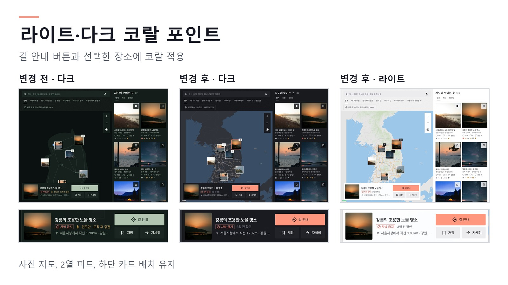
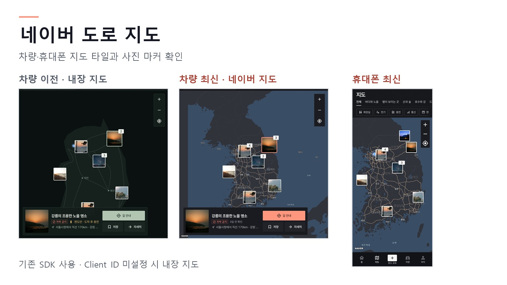
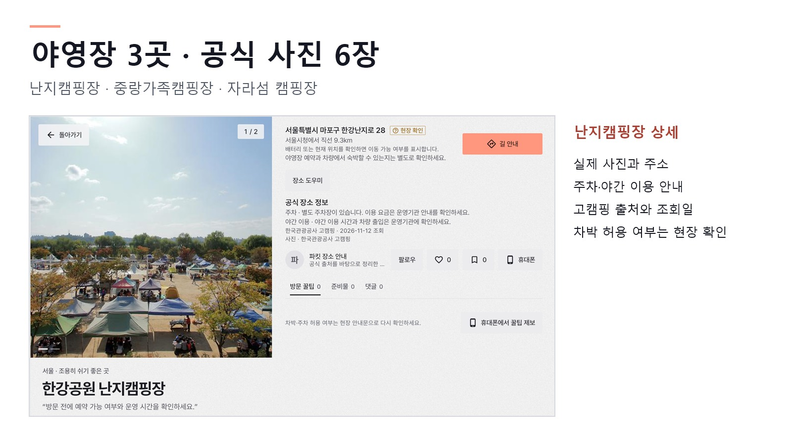
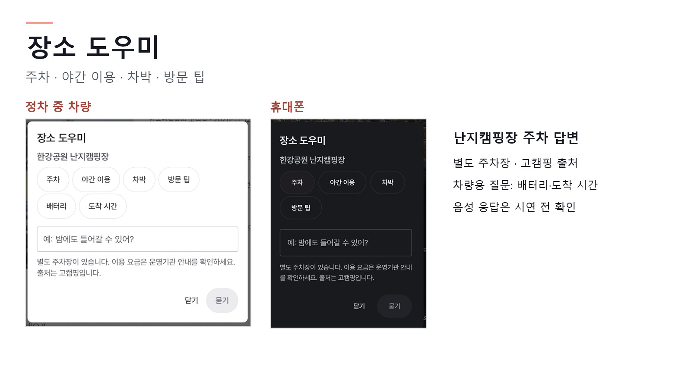
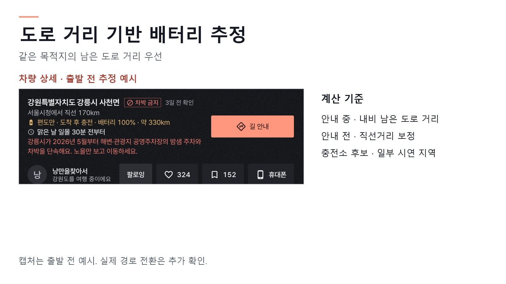
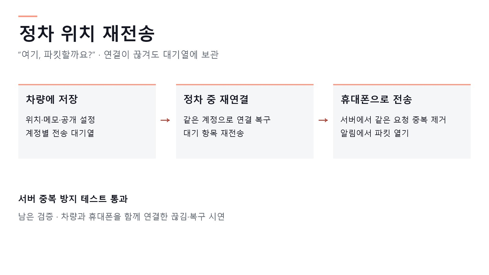
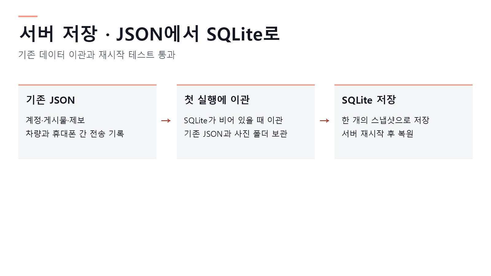
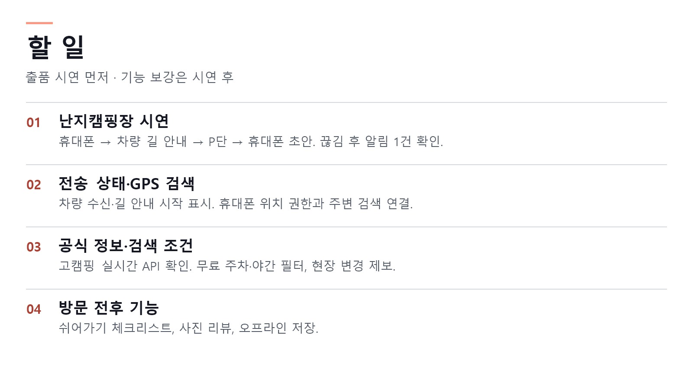

# PARK-IT 기능 현황과 시연 계획

2026-11-12 · 차량·휴대폰 앱 변경은 [`e218ee9…d3b4f0e`](https://github.com/newkimjiwon/hyundai-pleos/compare/e218ee9...d3b4f0e) 기준입니다. 팀 기능 정리와 Carvers 신청서의 앱 소개·이용 흐름을 현재 코드, 에뮬레이터 캡처, 테스트 결과에 대조했습니다.

신청서의 핵심 흐름은 **휴대폰에서 사진으로 장소 발견 → 차량으로 보내기 → 차량에서 이동·도착 정보 확인 → 정차 후 위치를 휴대폰으로 보내 방문 경험 공유**입니다. 출품 영상에서는 이 흐름을 한 장소로 이어서 보여 주고, 공식 사진·장소 도우미는 출발 전 확인 장면에서 보여 줍니다.

## 계획서와 현재 앱

| 계획 항목 | 현재 앱에서 할 수 있는 일 | 남은 일 |
| --- | --- | --- |
| 사진 지도·지역 피드·브랜딩 | 차량 사진 마커·묶음·2열 피드, 휴대폰 피드·지도, 파킷 이름과 P 로고. 네이버 도로 지도는 두 앱의 설정된 빌드에서 확인했습니다. | 출품용 APK에 지도 설정이 들어간 상태로 두 기기에서 다시 설치합니다. |
| 가까운 곳과 조건 검색 | 차량은 장소·지역·작성자를 검색하고, 내비 위치를 받으면 거리 판정에 사용합니다. 휴대폰에는 가까운 곳과 화장실·충전 등 시설 필터가 있습니다. | 휴대폰 가까운 곳은 현재 서울 기준입니다. 실제 위치 권한·거부 시 안내, 무료 주차·반려동물·진입로·야간 조건 필터가 남았습니다. |
| 실제 장소와 정보 신뢰도 | 난지·중랑·자라섬 야영장에 고캠핑 사진 2장씩, 주소·좌표·출처와 조회일을 표시합니다. 방문자 팁과 공식 안내 영역을 구분합니다. | 운영기관 정보의 갱신 주기, 고캠핑 실시간 API 확인, 현장 확인일 관리, 폐쇄·시설 변경 제보 반영이 남았습니다. 주차장과 차량 숙박 허용 여부는 각각 확인합니다. |
| 장소 상세와 도우미 | 주차·야간 이용·차박·방문 팁을 장소 상세에서 확인합니다. 차량은 배터리와 도착 시간을 추가로 묻는 항목이 있습니다. | 두 앱에서 주차 응답을 확인했습니다. 음성 질문·응답은 Pleos에서 재검증합니다. 자유 대화형 AI는 후순위입니다. |
| 차량 안내·주행 화면 | Pleos Vehicle SDK 기어·배터리와 NaviHelper의 위치·안내 상태를 사용합니다. 같은 목적지의 남은 도로 거리가 있으면 배터리 추정에 반영합니다. | 실제 안내 시작, 높은·낮은 잔량, P단 복귀를 한 흐름에서 검증합니다. 실시간 충전소 운영 상태와 실제 주행 전비는 후속입니다. |
| 휴대폰 → 차량 전송 | 개발용 서버의 6자리 연결과 차량의 ‘휴대폰에서 보냄’ 화면이 있습니다. | 실제 시연에서 수신 후 같은 장소를 다시 엽니다. ‘보냄 → 차량 수신 → 길 안내 시작’을 사용자에게 단계별로 표시하는 기능은 예정입니다. |
| 차량 → 휴대폰 파킷 | 정차 후 “여기, 파킷할까요?”에서 위치·메모·공개 설정을 보냅니다. 차량에 전송 대기열을 두고, 정차 중 다시 연결되면 재전송합니다. 서버는 같은 요청을 중복 처리하지 않습니다. | 두 앱을 동시에 켜고 연결을 끊었다 복구해 휴대폰에 한 건만 도착하는지 확인합니다. 도착 후 주차·준비물 체크리스트를 모아 보는 ‘쉬어가기’는 예정입니다. |
| 방문 경험 게시와 데이터 | 휴대폰의 사진·위치·공개 범위가 있는 게시물과 텍스트 후기·방문 팁이 구현돼 있습니다. 개발용 서버는 JSON에서 SQLite 스냅샷으로 이관합니다. | 방문일과 사진이 포함된 별도 리뷰, 여행 정보·사진 사전 다운로드, 출품 환경의 서버 연결과 보관 정책이 남았습니다. |
| 차내 제어 기획 | 휴대폰의 도어·창문·공조 화면은 데모입니다. 앱에서 사용하는 차량 데이터는 위치·기어·배터리·내비 안내 중심입니다. | 수면 모드, 12V·연료 상태 알림, 실내 공기질 조회 및 제어는 별도 기획입니다. 지원 센서·차종·권한과 실제 안전 검증이 선행돼야 합니다. |

## 변경 요소별 화면과 동작

### 코랄 테마

기존 세이지 그린에서 차콜·회색과 코랄로 바뀌었습니다. 정차 중 차량에서 길 안내와 선택 마커가 눈에 먼저 들어오도록 했습니다.

### 네이버 도로 지도

기존 SDK 연동을 실제 설정으로 열어 두 앱에서 도로 타일과 사진 마커를 확인했습니다. 이전 캡처는 Client ID가 없는 빌드의 간략 지도입니다.

### 공식 야영장 사진

난지캠핑장 상세에서 사진 두 장과 공식 장소 정보가 함께 보입니다. 나머지 두 곳도 같은 방식으로 사진과 출처를 갖습니다. 사진은 앱에 포함하고, 서버에 고캠핑 키가 설정되면 일치하는 제공처 자료를 조회하는 경로가 있습니다.

### 장소 도우미

차량과 휴대폰의 **장소 상세 → 장소 도우미 → 주차**에서 공식 안내와 출처를 확인했습니다. 입력 문구를 정해진 질문 유형에 연결해 해당 장소 데이터로 응답합니다.

### 경로와 배터리 추정

남은 도로 거리를 받으면 해당 목적지의 이동 가능 여부 계산에 사용합니다. 예시 화면은 길 안내 시작 전의 거리 보정 추정입니다. 충전소 후보는 일부 시연 지역에 한해 표시됩니다.

### 정차 위치 재전송

계정별 대기열에 위치·메모·공개 설정을 보관합니다. 같은 계정으로 정차 중 연결이 돌아오면 재전송하며, 서버 테스트에서 중복 수신이 없고 이미 열어 본 항목이 다시 나타나지 않는 것을 확인했습니다. 두 앱의 끊김·복구 시연은 다음 단계입니다.

### SQLite 저장

개발용 서버가 첫 실행에 기존 `state.json`을 이관하고 이후 SQLite 스냅샷을 사용합니다. 기존 사진 폴더는 계속 사용합니다. 이관과 재시작 후 데이터 유지가 서버 테스트를 통과했습니다.

## 다음 작업과 확인 방법

1. **출품 시연 한 번 완주.** 난지캠핑장을 휴대폰에서 열어 차량으로 보낸 뒤, 차량에서 같은 장소와 주차 안내를 확인합니다. 길 안내를 시작하고 주행 화면을 확인한 뒤 P단으로 전환합니다. 파킷으로 보낸 위치를 휴대폰 초안에서 엽니다.
2. **전송 대기와 수신 단계 확인.** 정차 후 서버를 잠시 끊고 위치를 보냅니다. 복구 후 휴대폰에 한 건만 오고 메모·위치 공개 설정이 유지되는지 봅니다. 그다음 휴대폰에서 보낸 장소의 차량 수신·길 안내 시작 상태를 구현합니다.
3. **현장 정보의 범위 확대.** 실제 위치와 권한 거부 흐름을 시험하고, 필요한 조건으로 좁혀 찾을 수 있게 합니다. 대표 장소의 운영기관 안내 갱신과 현장 변경 제보를 먼저 다룹니다.
4. **쉬어가기와 방문 이후 기능.** 도착 후 주차 안내와 준비물 체크리스트를 묶고, 사진 리뷰와 여행 정보 사전 다운로드를 순서대로 검토합니다. 차내 제어는 지원 범위를 확인한 뒤 별도로 다룹니다.

2026-11-12 검증에서 차량·휴대폰 디버그 APK 빌드와 서버 20개·코어 22개·차량 9개 테스트가 통과했습니다. 지도와 공식 사진, 도우미 답변은 에뮬레이터에서 확인했습니다. [시연 순서와 촬영 체크리스트](demo.md)

